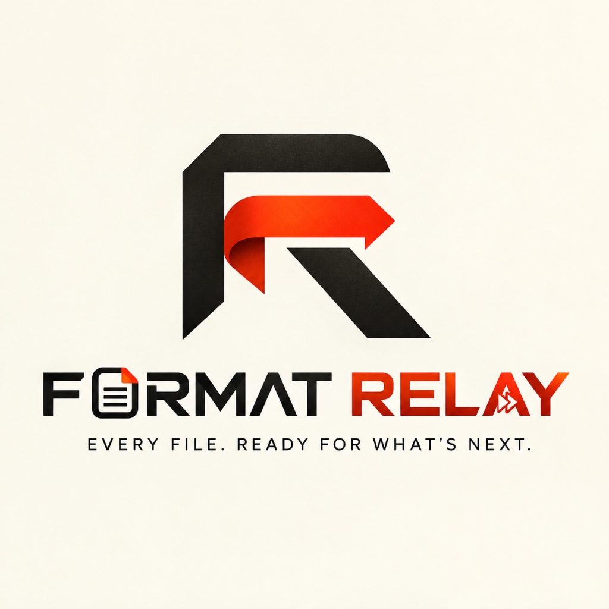

<p align="center">
  
</p>

<p align="center">
  <strong>Every file. Ready for what's next.</strong><br>
  <em>Engineered for instant speed and tactile precision by <strong>Code & Chaos Studio</strong>.</em>
</p>

<p align="center">
  <a href="#-the-gta-v-weapon-wheel-mechanic"></a>
  <a href="#-official-windows-releases"></a>
  <a href="#-studio-identity--ownership"></a>
  
  
  
</p>

---

## ⚡ Why Format Relay?

Traditional file converters force you into an exhausting multi-step ritual: open a browser, search for a sketchy converter, upload your private files, wait in line, solve captchas, and download a zip file.

**Format Relay kills that entire workflow.**

Inspired by the iconic, rapid-fire flick-and-release mechanics of the **GTA V weapon wheel**, Format Relay places a high-performance **Format Wheel** directly under your cursor in Windows. No windows cluttering your desktop, no uploads, and zero cloud delay.

```
 Traditional Web Converter (45s+)     │  Format Relay Tactical Wheel (< 0.2s)
 ─────────────────────────────────────┼──────────────────────────────────────
 1. Open browser & search tool        │  1. Hold Left Shift + Right Mouse Drag
 2. Upload file to remote server      │  2. Flick onto target format wedge
 3. Wait for cloud processing queue   │  3. Release — Done beside original!
 4. Solve annoying captchas           │     (100% Offline & Private)
 5. Download & unpack zip             │
```

---

## 🎮 The GTA V Weapon-Wheel Mechanic

Converting any file on your computer takes **three intuitive gestures**:

### 1. Select & Drag
Select one or more files in File Explorer, on your desktop, or anywhere on screen. Hold <kbd>Left Shift</kbd> and slightly drag using your **Right Mouse Button** (or Left Mouse Button).

### 2. Aim on the Wheel
The **Format Wheel HUD** blooms instantly at your cursor coordinates with zero window borders, zero scrollbars, and a sharp tactical reticle. Only the exact formats supported for your specific file type are displayed.

### 3. Flick & Release
Flick your cursor onto the target wedge (e.g., `JPG`, `PNG`, `PDF`, `WebP`) and let go. In **a fraction of a second**, the converted file appears right beside the original file in the same directory!

> 💡 **Instant Cancellation**: Releasing the mouse button or releasing <kbd>Left Shift</kbd> outside any wedge instantly dismisses the wheel without altering any files.

---

## 🖥️ Top Navigation Command Center

Format Relay v1.0 features a custom **Top Navigation Command Deck**:

- **🏠 Home**: Real-time background engine status, live gesture guide, and interactive drag-and-drop testing arena.
- **⚙️ General Settings**: Output destination configuration (*Beside Original File* vs *Custom Download Folder*), Windows startup autostart, and system tray minimization.
- **⌨️ Shortcuts**: Clean single-gesture view highlighting the signature **<kbd>Left Shift</kbd> + Right Mouse Drag** trigger.
- **⚡ Engines (250+ Formats)**: Complete catalog of native conversion pipelines running locally on your hardware.
- **🛡️ About Studio**: The Code & Chaos Studio story, founder attribution, update notifications, and our lifetime-free guarantee.

---

## 📦 Supported Formats Matrix

All conversions run **100% offline** on your machine with native C#/.NET 10 hardware acceleration:

| Category | Supported Formats | Native Features |
| :--- | :--- | :--- |
| **🎨 Images** | `PNG`, `JPEG`, `WEBP`, `AVIF`, `TIFF`, `BMP`, `ICO`, `SVG`, `GIF`, `HEIC` | Lossless recompression, quality dials (`70%`, `85%`, `100%`), EXIF preservation |
| **📄 Documents** | `PDF`, `DOCX (Word)`, `HWPX`, `EPUB`, `TXT`, `Markdown`, `HTML` | Converts Office documents locally with **zero** MS Office or LibreOffice installation |
| **🎬 Video** | `MP4`, `MP4 720p`, `WEBM`, `MOV`, `MKV`, `AVI`, animated `GIF` | High-speed multi-threaded encoding |
| **🎧 Audio** | `MP3`, `MP3 320k`, `WAV`, `FLAC`, `AAC`, `OGG` | Bitrate presets, lossless audio preservation |
| **📊 Data** | `JSON`, `CSV`, `YAML`, `TOML`, `TSV` | Instant schema translation and structured table export |

---

## 🚀 Official Windows Releases

The official Windows binaries are built directly into [`dist/release/windows/`](dist/release/windows/):

| Binary | Type | Size | Description |
| :--- | :--- | :--- | :--- |
| [**`FORMAT_RELAY_1.0.0_Setup.exe`**](dist/release/windows/FORMAT_RELAY_1.0.0_Setup.exe) | **Full Installer** | ~131 MB | Complete self-contained installer. Configures Start Menu, desktop shortcuts, and silent background tray auto-start. |
| [**`FORMAT_RELAY_Portable.exe`**](dist/release/windows/FORMAT_RELAY_Portable.exe) | **Standalone Portable** | ~80 MB | Single-file zero-install executable. Run instantly from any folder or USB drive. |

---

## 🛠️ Architecture & Technology Stack

Format Relay is engineered from scratch for minimum latency and maximum desktop integration:

1. **Application Core**: .NET 10 (C#) native AOT/ReadyToRun compiled binaries for near-zero startup time.
2. **Radial HUD Layer**: Borderless, hardware-accelerated Avalonia UI + Skia vector graphics.
3. **Low-Level Input Hook**: High-precision global mouse and keyboard gesture tracking via native Win32/SharpHook integration.
4. **Shell Integration**: Direct COM integration with Windows Explorer tabs and desktop worker windows (`WorkerW`/`Progman`).

---

## 🛡️ Studio Identity & Ownership

- **Studio**: **CODE & CHAOS STUDIO** *(operating also as Code & Share Studio)*
- **Core Engineering**: Owned, designed, and developed exclusively by the **three founding developer-owners**.
- **Official Repository**: [github.com/codeandchaos-studio/Format-Relay](https://github.com/codeandchaos-studio/Format-Relay)
- **Official Portal**: [codeandchaos.studio](https://codeandchaos.studio/)
- **Pricing**: **100% Free Lifetime Tool** for all users.

> [!IMPORTANT]
> **PROPRIETARY SOURCE-AVAILABLE LICENSE:**  
> This software and source tree are strictly reserved for the founding developer-owners of Code & Chaos Studio.  
> - **NO CLONING / FORKING**: Public mirroring, scraping, or forking of this repository is strictly prohibited under our license.  
> - **NO REUSE**: No portion of the source code, UI geometry, or compiled binaries may be repackaged, resold, or redistributed.  
> - **OFFICIAL UPDATES ONLY**: All feature additions, patches, and release builds are published exclusively through our official studio channels.

---

<p align="center">
  <strong>Format Relay</strong> · Built with passion by <strong>Code & Chaos Studio</strong>
</p>
